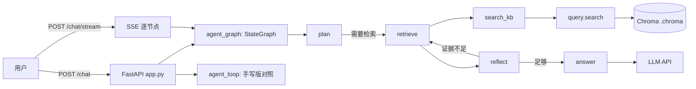

# 私有文档问答与工具调用 Agent

给一批私有 Markdown 文档，能问答、能拒答、能调用工具，并用一张评测表证明效果。

**在线 Demo**：https://llm-app-portfolio.onrender.com

> 当前进度：Day 6 / 7 —— 最小 RAG + 评测 + 工具调用 + FastAPI 服务已跑通

## 两个项目

1. 本项目：手写 RAG + 工具调用 + 评测（第 0 周完成）
2. 带权限边界的业务 Agent（第 3–4 周）

## 技术栈

Python 3.10+ · OpenAI 兼容 API · Chroma · LangGraph · FastAPI + Docker

## 快速开始

```bash
# 1. 环境
python -m venv .venv
source .venv/Scripts/activate        # Git Bash；PowerShell 用 .\.venv\Scripts\Activate.ps1
pip install -r requirements.txt

# 2. 配置（填 4 个变量：LLM_API_KEY / LLM_BASE_URL / LLM_MODEL / EMBED_MODEL）
cp .env.example .env

# 3. 建索引
python ingest.py

# 4. 提问（交互式，会打印 3 个命中片段 + 来源 + distance + 答案）
python query.py

# 5. 连通性自检（打印 ANSWER / TOKENS / LATENCY）
python smoke_test.py
```

### 本机服务（FastAPI）

```bash
uvicorn app:app --host 127.0.0.1 --port 8000
# 另开一个终端
curl http://127.0.0.1:8000/health
curl -X POST http://127.0.0.1:8000/chat \
  -H "Content-Type: application/json" \
  -d '{"question":"知识库里 chunk_size 默认多少"}'

# 流式（SSE，逐节点推送 plan/retrieve/reflect/answer）
curl -N -X POST http://127.0.0.1:8000/chat/stream \
  -H "Content-Type: application/json" \
  -d '{"question":"知识库里 chunk_size 默认多少"}'
```

## 语料

`data/corpus/` 不进版本库（见 `.gitignore`），请自备 Markdown 文档放进去，例如：

```bash
mkdir -p data/corpus
cp /path/to/your/notes/*.md data/corpus/
```

本项目开发时用自己写的知识库笔记作为语料（11 篇），好处是答案已知、便于出评测题。

## 目录结构

```text
.
├── ingest.py        # 切片 + embedding + 入 Chroma
├── query.py         # 检索 + 拼 prompt + 生成（search() 供 Day5 复用）
├── smoke_test.py    # 最小连通性自检
├── check.py         # 交付自检（待补）
├── tools.py         # 工具调用（Day5）
├── agent_loop.py    # 手写分发循环（Day5）
├── app.py           # FastAPI 服务（Day6）
├── eval/            # 评测集与评测脚本（Day3）
├── data/corpus/     # 语料（不提交）
└── .chroma/         # 本地向量库（不提交）
```

## 架构



`/chat` 走 LangGraph 版（`plan → retrieve → reflect → answer`，条件边 + 15s 检索超时）；`/chat/handwritten` 保留 Day5 的手写循环做对照；`/chat/stream` 用 SSE 逐节点推送，复杂问题可能 10–30 秒。

## 部署

### Docker

```bash
# 本地先建好索引，否则镜像里没有 .chroma
python ingest.py
docker build -t kb-agent .
docker run --rm -p 8000:8000 --env-file .env kb-agent
curl http://127.0.0.1:8000/health
```

`.env` 不进镜像（`.dockerignore` 已忽略），运行时用 `--env-file` 注入。

### 三类部署方式（按 15 分钟能出链接挑）

| 方式 | 适合 | 注意 |
| --- | --- | --- |
| 内网穿透（本机 uvicorn + 穿透工具） | 最快，无需构建 | 本机关机就失效，README 注明 |
| 免费容器托管（认 Dockerfile） | 有 Dockerfile 即可 | 首次构建可能超过 15 分钟 |
| 已有云服务器（docker run） | 手上有机器 | 注意端口与安全组 |

判断标准只有一条：别人能不能打开并问出一个正确答案。

## 评测

样本 20 条（10 `answerable` / 5 `no_answer` / 5 `multi_chunk`），语料 11 篇，运行日期 2026-11-18。

| 指标 | 数值 | 说明 |
| --- | --- | --- |
| 检索命中率 | 0.90 | 9/10 answerable 的 top3 命中正确文档 |
| 拒答正确率 | 1.00 | 5/5 no_answer 正确拒答 |
| expect 覆盖率 | 0.80 | 12/15 answerable + multi 的答案含全部关键词 |

运行 `python eval/eval.py` 生成 `eval/runs/before.json`（不进 git）。

### 两个失败案例

- **q05 检索未命中**：问「容器里检索为空，通常是什么原因？」，top3 命中的是 Day2/Day5 的「卡住」段落，没有命中 Day6 的「`.chroma/` 没进镜像」。归因：固定 500 字窗口把表格行切碎，纯向量对「容器 / 镜像」这类实体不敏感。
- **q04 命中但证据不足**：问「Day4 建议把 overlap 从多少改到多少？」，命中了 Day4 文档，但 top3 是 frontmatter，没有覆盖正文里的「50 → 100」，模型按拒答规则回答「资料中没有」。归因：关键句被切到相邻 chunk，top3 未召回。

同类问题还有 q20（Day5 → Day6 的多跳问题，代码块未进 top3）。这三条都指向同一件事：**切分粒度与检索策略**，是 Day4 单变量优化的输入。

> 评测样例本身不会进检索库：`ingest.py` 会跳过含 `"expect"` / `"id":"q"` 的片段，避免模型直接复述 `cases.jsonl`。

## Day4 单变量实验：OVERLAP 50 → 100

**假设（写在结果之前）**：把 `ingest.py` 的 `OVERLAP` 从 50 提到 100，会让 q04、q05 的检索改善。理由：这两题的关键句都贴着段落/表格边界，50 字重叠不足以让相邻 chunk 同时覆盖「问题关键词 + 答案句」；预期 `retrieval_hit_rate` 与 `expect_coverage` 上升，`refuse_correct_rate` 不受影响。

**改动范围**：只改 `CHUNK, OVERLAP = 500, 100` 这一处，prompt、模型、切分大小都不动。

**结果（2026-11-18，同一套 20 条）**

| 指标 | before（OVERLAP=50） | after（OVERLAP=100） | 变化 |
| --- | --- | --- | --- |
| 检索命中率 | 0.90 | 0.80 | -0.10 |
| 拒答正确率 | 1.00 | 1.00 | 0 |
| expect 覆盖率 | 0.80 | 0.60 | -0.20 |
| 索引片段数 | 71 | 75 | +4 |

**逐条变化**：q01、q03、q18 从通过变失败，q04 从「命中但证据不足」退化为「未命中」；q05、q20 仍然失败。

**归因（假设不成立）**：

1. 主因是**同文档重复片段挤占 top3**。overlap 从 50 提到 100 后，相邻 chunk 重叠 20%，同一文档的相似片段更容易同时进入 top3。q18 最典型：问题问「投 30 份 0 面试」，检索却把「投递 15 份 0 回应」那条表格行排到前面，答案因此答非所问。
2. 次因是**边界片段被过度召回**。q01 的答案直接复述了问题本身，说明含示例问句的 chunk 被拉进了上下文。
3. q03 的 `MAX_ROUNDS = 3` 关键句被重叠片段挤出 top3，模型改为拒答。

**结论**：单纯增大 overlap 不是有效优化。下一步应优先做候选 ③「来源去重」（先解决同文档重复召回），再回头评估 overlap。

**实验后处理**：已把 `OVERLAP` 回退到 50 并重建索引（71 片段），`after.json` 保留在本地作为实验记录。

## Day5 工具调用与异常处理

手写分发循环，不用任何 Agent 框架：`tools.py` 提供 `search_kb` / `calculator` 两个工具，`agent_loop.py` 负责 tool_calls → 执行 → 回灌 → 出答案，最多 3 轮。

**关键设计**：

- 工具异常不抛栈给用户，而是回灌 `TOOL_ERROR: <类型>: <原因>。请修正参数，或说明无法完成。`
- 达到 3 轮上限时，兜底回复带上最后一次工具错误，而不是静默返回空结果
- 用 `FAULT_MODE=missing|raise` 复现两类失败，不依赖真实故障

### 4 段对话记录（2026-11-19）

**① 成功：工具调用 → 回灌 → 正确答案**

```text
问题：知识库里 chunk_size 和 overlap 默认是多少
答：根据知识库的检索结果……chunk_size 默认值是 500，overlap 默认值是 50。
```

**② 模型不调工具（闲聊，循环正常退出）**

```text
问题：你好，你是谁
答：你好！我是 DeepSeek……（直接回答，未触发工具）
```

**③ 参数缺失（FAULT_MODE=missing）**

```text
问题：知识库里 chunk_size 默认多少
答：已达到工具调用上限（3 轮），无法继续。最后一次工具错误：
    ValueError: 缺少 query 参数，请提供检索关键词。请把问题拆小或补充信息。
```

**④ 工具内部异常（FAULT_MODE=raise）**

```text
问题：知识库里 chunk_size 默认多少
答：工具调用失败，向量库连接超时。根据工具的使用规则，我不能凭记忆回答
    事实性问题，必须如实说明工具失败及原因。知识库检索工具当前连接超时，
    我无法为您查询到关于 chunk_size 默认值的具体信息……
```

三类失败都没有 traceback、没有卡死、都说明了发生了什么。

## 第 1–2 周：LangGraph 版

手写循环保留在 `agent_loop.py` 作对照，新链路在 `agent_graph.py`：

- **四个节点**：`plan`（判断是否需要检索）→ `retrieve`（`search_kb`，15s 超时）→ `reflect`（证据是否为空）→ `answer`（拼上下文生成）
- **条件边**：`route_plan` 决定直接答还是检索；`route_reflect` 在证据不足且未达 2 轮时回到 `retrieve`，否则进入 `answer`
- **结构化日志**：每个节点输出 JSON（event / round / hits / tokens / ms / error），便于算成本和延迟
- **流式**：`POST /chat/stream` 用 SSE 推送节点事件，实测序列 `plan → retrieve(5 hits) → reflect → answer`
- **CI**：`.github/workflows/ci.yml` 提交即跑导入检查 + `check.py`

复盘见 [`docs/retro_langgraph.md`](docs/retro_langgraph.md)。

## 已知限制

- 固定窗口切分（500 / 50），片段不带章节上下文，跨章节问题命中率有限
- 纯向量检索，对型号、编号等精确串不敏感（Day 4 计划加 BM25 + 重排）
- 单机 Chroma，未做并发与权限
- 免费实例休眠：Render 免费实例 15 分钟无请求会休眠，冷启动约 30–60 秒
- 启动时重建索引：容器启动会跑 `ingest.py`（约 1–2 分钟），首次请求较慢，并消耗 embedding 额度
- 编号/代码常量类问题（如「Day5 最多几轮」）检索不稳定，可能只给出定性回答；根因是固定切分 + 纯向量，需 Day4 的 BM25 混合检索解决
- 容器里没有 `.chroma/` 时检索为空
- 仅支持文字版 Markdown

## License

MIT
